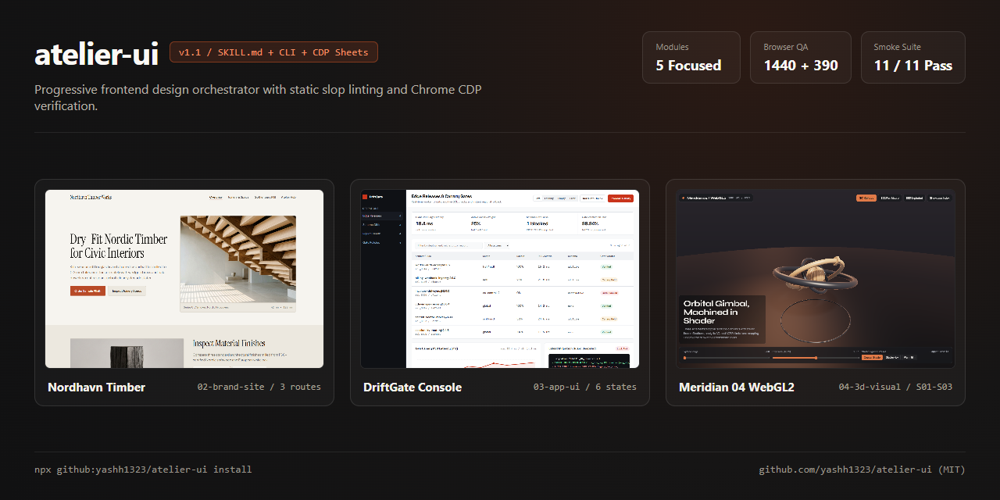
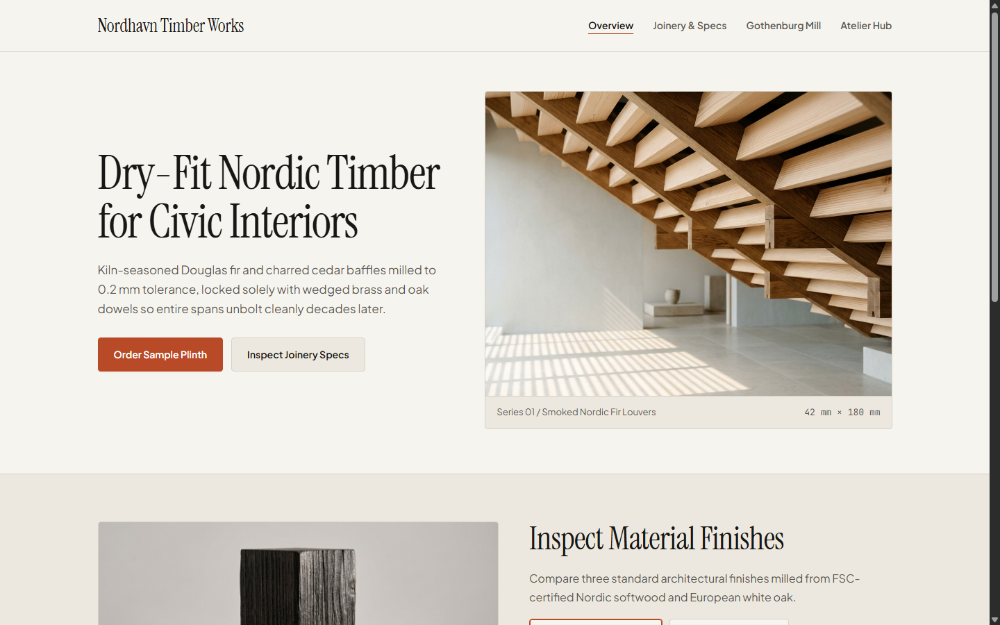
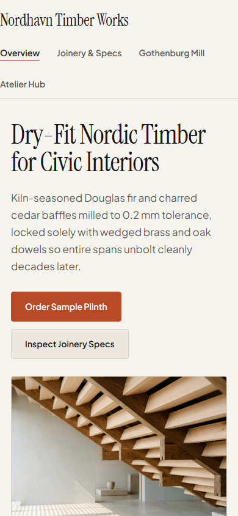
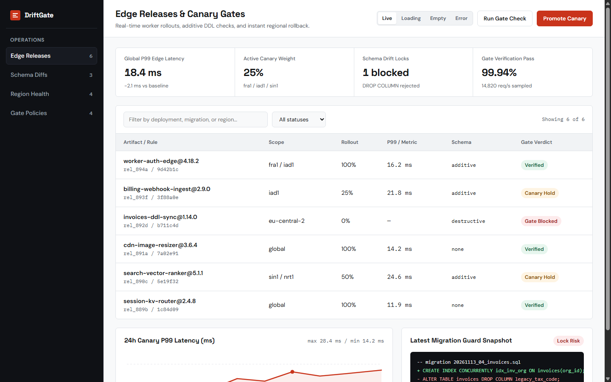
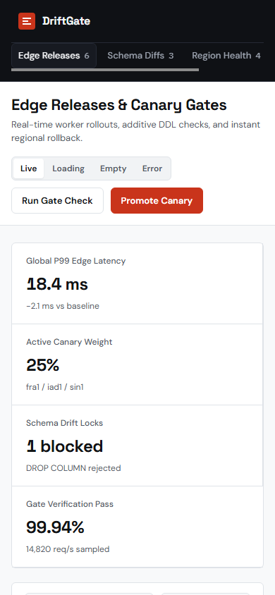
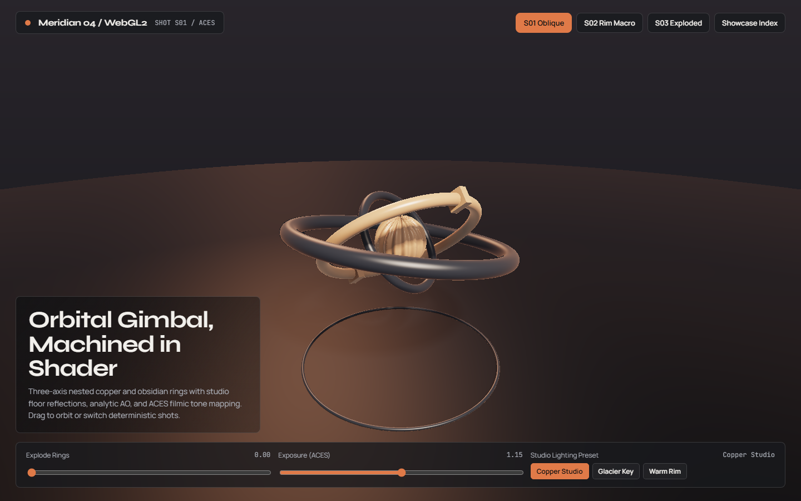
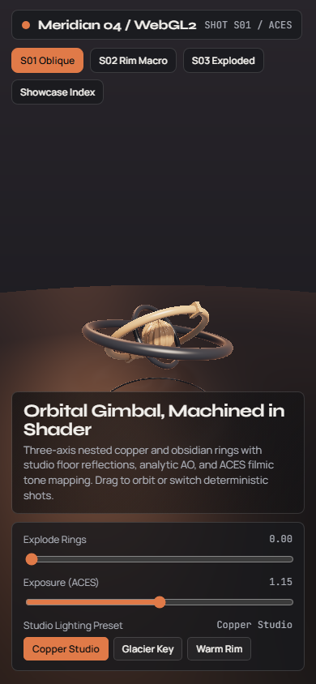

<div align="center">

# atelier-ui

**An adaptive frontend design skill (`SKILL.md`) and zero-dependency Chrome CDP verifier for AI coding agents.**

Probes your repository once, resolves open constraints in a single turn, loads only the playbook your project type needs, and checks real browser pixels before handing back.

[](https://github.com/yashh1323/atelier-ui/actions/workflows/ci.yml)
[](LICENSE)
[](scripts/check-ui.mjs)
[](tests/smoke.mjs)
[](docs/PROOFS.md)

<br />



</div>

---

## Why agents still ship generic UI

Most frontend skill files stuff brand landing advice, dashboard ergonomics, and WebGL guidance into one giant prompt—and silently assume third-party CLIs are already installed. Tell an AI agent to fix a Next.js table with that setup and it may start inventing sourdough-style hero typography or failing on missing global packages.

`atelier-ui` separates discovery, styling direction, and verification into focused modules for **Antigravity**, **Claude Code**, **Codex CLI**, and **Cursor** across static HTML, **React**, **Next.js**, **Tailwind CSS**, **shadcn/ui**, **Astro**, **Vue**, **Svelte**, and **Three.js / WebGL**.

---

## Live Proof & Rendered Output

Explore the live interactive 3-mode showcase at **[yashh1323.github.io/atelier-ui-showcase](https://yashh1323.github.io/atelier-ui-showcase/)** ([Nordhavn Timber](https://yashh1323.github.io/atelier-ui-showcase/timber/), [DriftGate Console](https://yashh1323.github.io/atelier-ui-showcase/driftgate/), and [Meridian 04 WebGL2](https://yashh1323.github.io/atelier-ui-showcase/astrolabe/)).

Every screenshot below was rendered by `atelier-ui` workflows, linted with [`lint-ui.mjs`](scripts/lint-ui.mjs), and captured in headless Google Chrome at `1440×900` (desktop) and `390×844` (mobile) via [`check-ui.mjs`](scripts/check-ui.mjs). Full JSON telemetry and smoke test logs live in [`docs/PROOFS.md`](docs/PROOFS.md).

<table>
  <tr>
    <th align="left">Surface &amp; Module</th>
    <th align="left">Desktop (<code>1440×900</code>)</th>
    <th align="left">Mobile (<code>390×844</code>)</th>
    <th align="left">Measured QA Gate</th>
  </tr>
  <tr>
    <td>
      <strong>Nordhavn Timber</strong><br />
      <code>02-brand-site.md</code><br />
      <sub><code>Persuade</code> · <code>product</code> · <code>editorial-stone</code></sub>
    </td>
    <td></td>
    <td></td>
    <td>
      <strong>Lint + CDP: PASS</strong><br />
      <sub><code>0</code> fails, <code>0</code> warns, <code>3</code> routes verified, <code>5/5</code> webfonts loaded, <code>0</code> AA contrast errors</sub>
    </td>
  </tr>
  <tr>
    <td>
      <strong>DriftGate Console</strong><br />
      <code>03-app-ui.md</code><br />
      <sub><code>Operate</code> · <code>6 UI states</code> · <code>tabular-nums</code></sub>
    </td>
    <td></td>
    <td></td>
    <td>
      <strong>Lint + CDP: PASS</strong><br />
      <sub><code>0</code> fails, <code>0</code> warns, <code>scrollWidth 390</code>, <code>6/6</code> webfonts loaded, <code>0</code> console errors</sub>
    </td>
  </tr>
  <tr>
    <td>
      <strong>Meridian 04 Astrolabe</strong><br />
      <code>04-3d-visual.md</code><br />
      <sub><code>3D</code> · WebGL2 GLSL · <code>S01–S03</code></sub>
    </td>
    <td></td>
    <td></td>
    <td>
      <strong>Lint + CDP: PASS</strong><br />
      <sub><code>0</code> fails, <code>0</code> warns, WebGL2 rendered, <code>3</code> camera shots, <code>0</code> AA contrast errors</sub>
    </td>
  </tr>
</table>

---

## Install

Install or update across detected agent directories using the built-in zero-dependency CLI ([`bin/atelier-ui.mjs`](bin/atelier-ui.mjs)):

```bash
npx github:yashh1323/atelier-ui install
npx github:yashh1323/atelier-ui doctor
```

Or install directly using the [`skills`](https://github.com/vercel-labs/skills) CLI:

```bash
npx skills add yashh1323/atelier-ui
```

Or clone into your agent's skill directory:

| Agent / Tool | Global Skill Path | Workspace-Local Path |
|---|---|---|
| **Antigravity** | `~/.gemini/config/skills/atelier-ui` | `.agents/skills/atelier-ui` |
| **Claude Code** | `~/.claude/skills/atelier-ui` | `.claude/skills/atelier-ui` |
| **Codex CLI** | `~/.codex/skills/atelier-ui` | `.codex/skills/atelier-ui` |
| **Cursor** | `~/.cursor/skills/atelier-ui` | `.cursor/skills/atelier-ui` |

On **Windows**, link a local clone globally without Administrator privileges using a directory junction:

```powershell
New-Item -ItemType Directory -Force "$env:USERPROFILE\.gemini\config\skills" | Out-Null
New-Item -ItemType Junction -Path "$env:USERPROFILE\.gemini\config\skills\atelier-ui" -Target "C:\path\to\atelier-ui"
```

---

## Requirements

- **Node.js 18+** runs [`scripts/detect-env.mjs`](scripts/detect-env.mjs) and [`scripts/lint-ui.mjs`](scripts/lint-ui.mjs).
- **Node.js 22+** (native `WebSocket`) paired with local **Google Chrome, Microsoft Edge, Chromium, or Brave** runs [`scripts/check-ui.mjs`](scripts/check-ui.mjs). Set `CHROME_PATH` if your browser binary lives outside standard system paths.

When `impeccable` or `agent-browser` are present on your `PATH`, `detect-env.mjs` detects them and `05-qa-gate.md` delegates to them first. When neither is installed, the built-in Node scripts run out of the box with zero `npm install` steps.

---

## Architecture & Routing

[`SKILL.md`](SKILL.md) acts as the lightweight router—only the module matching the current project enters agent context:

```text
detect-env.mjs ──▶ 01-intake.md (.atelier/BRIEF.md)
                         │
        ┌────────────────┼────────────────┐
        ▼                ▼                ▼
 02-brand-site.md   03-app-ui.md    04-3d-visual.md
 (+ themes.json)    (existing UI)   (WebGL / GLSL)
        │                │                │
        └────────────────┼────────────────┘
                         ▼
         05-qa-gate.md (lint-ui ──▶ check-ui CDP ──▶ Tier 3 Critic)
```

| File | Responsibility |
|---|---|
| [`scripts/detect-env.mjs`](scripts/detect-env.mjs) | Scans `package.json`, lockfiles, `components.json`, `PRODUCT.md`/`DESIGN.md`, and local CLI/browser binaries once. |
| [`modules/01-intake.md`](modules/01-intake.md) | Resolves surface mode (`Persuade`, `Experience`, `Operate`, `Read`, `3D`), stack, direction, and QA depth in one message, saving `.atelier/BRIEF.md`. |
| [`modules/02-brand-site.md`](modules/02-brand-site.md) + [`library/themes.json`](library/themes.json) | Classifies business kind (`software`, `gaming`, `tech`, `product`, `service`, `place`), rotates away from recent picks via `.atelier/history.json`, and checks the nav + hero in Chrome before building lower sections. |
| [`modules/03-app-ui.md`](modules/03-app-ui.md) | Preserves existing design tokens (`Tailwind`, `shadcn/ui`, `Next.js`, `Astro`, `Vue`, `Svelte`), adds surgical steering (`bolder`, `quieter`, `distill`, `typeset`, `layout`, `harden`), and enforces interactive UI states. |
| [`modules/04-3d-visual.md`](modules/04-3d-visual.md) | Establishes camera presets (`.atelier/SHOTS.md`), deterministic `?shot=...&frame=...` stepping alongside live animation, software-WebGL handling, and bounded round logs (`.atelier/ROUNDS.md`). |
| [`modules/05-qa-gate.md`](modules/05-qa-gate.md) | Runs Tier 1 slop lint, Tier 2 desktop + mobile browser verification (`1440×900` & `390×844`), and optional zero-context screenshot critique. |

---

## What Scripts Verify (and What They Don't)

- **Static UI Linter ([`lint-ui.mjs`](scripts/lint-ui.mjs)):** Scans `.html`, `.css`, `.jsx`, `.tsx`, `.vue`, `.svelte`, and `.astro` files for layout traps and AI slop (`100vw`, `w-screen`, `transition: all`, missing `:focus-visible`, placeholder text, eyebrow kickers directly preceding `<h1>`, middot metadata runs, missing `prefers-reduced-motion`, default indigo/purple gradients). On existing component kits such as `shadcn/ui`, pass only your authored directories so untouched primitives are ignored.
- **Headless Browser QA ([`check-ui.mjs`](scripts/check-ui.mjs)):** Drives Chrome DevTools Protocol (`CDP`) across static folders (including multi-page `--routes`, multi-angle `--shots`, side-by-side `--sheet` contact sheets, and `--ref` comparisons) or live `http://localhost` dev servers. Fails on navigation/4xx/5xx same-origin request errors, blank viewports, horizontal overflow, broken images, zero-box SVGs/canvases (`emptyMedia`), fixed/sticky header-over-`h1` overlap, dead `#` links, WCAG AA contrast failures (including `oklch()` / CSS Color 4), `< 12px` visible text, uncaught runtime exceptions, and `console.error` calls.
- **Visual & Structural Judgment:** Card-in-card nesting, `minmax(0, 1fr)` image grid discipline, whitespace balance, and typographic hierarchy cannot be proved by regex or DOM telemetry alone—those are checked directly by inspecting the captured `1440×900` and `390×844` screenshots or `--sheet` contact sheets (or via a fresh-context Tier 3 critic subagent).

---

## Smoke Tests

```bash
node --test tests/smoke.mjs
```

Runs 11 test groups covering `SKILL.md` references, word budgets & link integrity, `library/themes.json` WCAG AA contrast and schema validity, `bin/atelier-ui.mjs` cross-platform installation & `doctor`, `detect-env.mjs` framework detection, `lint-ui.mjs` JSX/multi-ID/comment rules, `resolveSafeFile` traversal blocking, and live Chrome CDP `--routes`/`--shots`/`--sheet` + HTTP verification. Full test output is archived in [`docs/PROOFS.md`](docs/PROOFS.md).

---

## License

[MIT](LICENSE)
