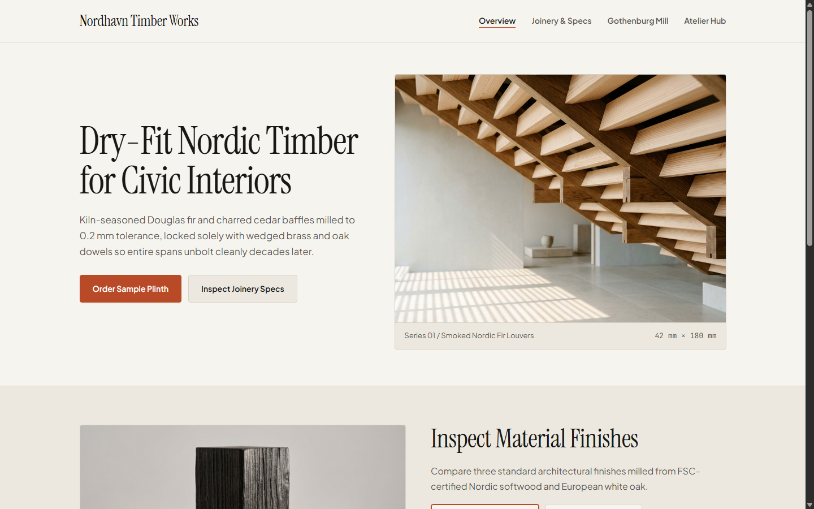
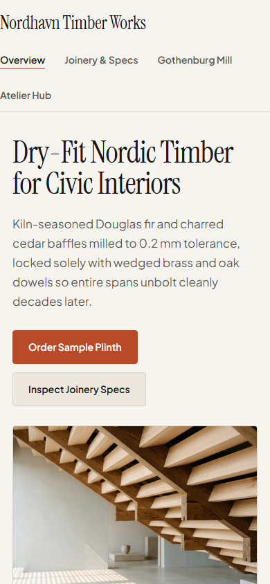
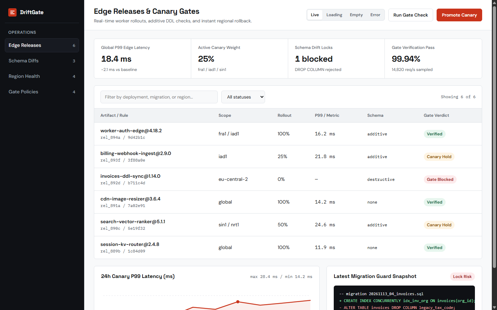
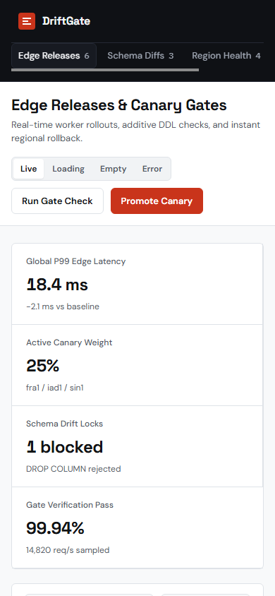
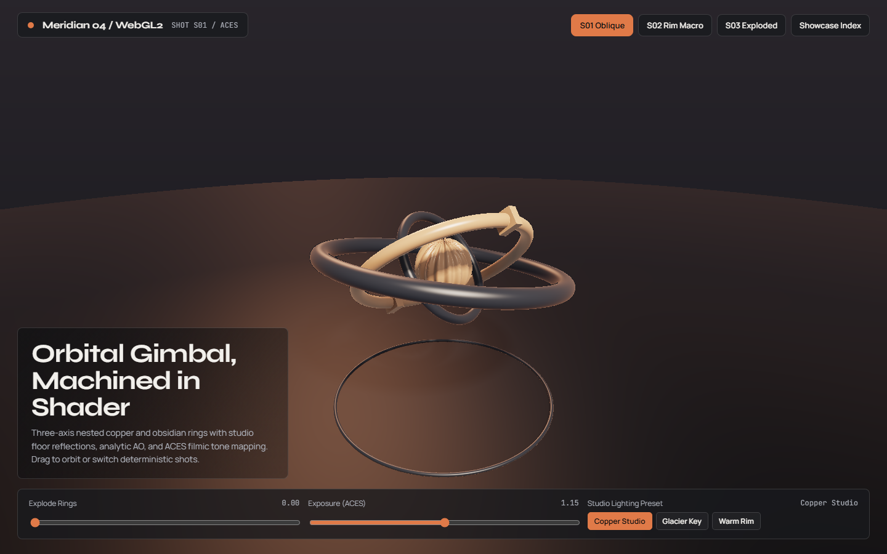
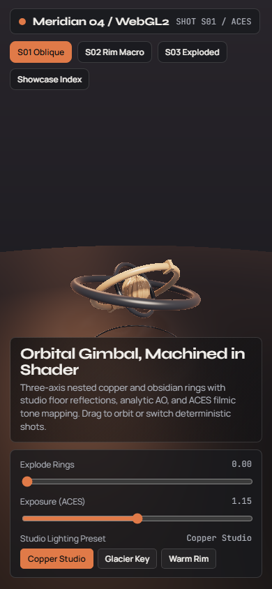

# Verification Proofs & Visual Builds

Every command result and screenshot below comes from direct runs of `atelier-ui` on **Node.js v22.23.2** and local **Google Chrome (CDP)**, backed by automated CI runs in [`.github/workflows/ci.yml`](../.github/workflows/ci.yml) on **Ubuntu (`ubuntu-latest`, Node 22 + `google-chrome`)**.

Live interactive showcase hub: **[yashh1323.github.io/atelier-ui-showcase](https://yashh1323.github.io/atelier-ui-showcase/)**

---

## 1. Automated Smoke Suite (`tests/smoke.mjs`)

All 11 test groups pass end-to-end with zero external npm dependencies:

```text
TAP version 13
ok 1 - SKILL.md frontmatter and referenced files exist
ok 2 - library/themes.json has valid schema, business kinds, and WCAG AA contrast
ok 3 - detect-env.mjs outputs valid environment JSON
ok 4 - detect-env.mjs detects Next.js/pnpm/shadcn, Vite/Three.js, and invalid package.json
ok 5 - lint-ui.mjs handles clean fixtures, JSX, multi-ID disables, comments, and multi-line CSS
ok 6 - resolveSafeFile blocks path traversal and sibling-prefix escapes
ok 7 - check-ui.mjs verifies clean/failing fixtures, console.error, tinyText, oklch contrast, and canvas overlays
ok 8 - check-ui.mjs verifies live HTTP server and fails on unreachable HTTP server
ok 9 - skill word-budget and markdown local asset links stay intact
ok 10 - bin/atelier-ui.mjs handles flags, real link creation, conflict skip, --force, and doctor
ok 11 - check-ui.mjs supports --routes, --shots, --sheet, and catches overlap, emptyMedia, 404, and blank renders
1..11
# tests 11
# pass 11
# fail 0
# skipped 0
```

---

## 2. Multi-Mode Reference Builds

Each build started from `detect-env.mjs`, loaded only its matching playbook (`02-brand-site.md`, `03-app-ui.md`, or `04-3d-visual.md`), passed `lint-ui.mjs` (`0 FAIL, 0 WARN`), and passed `check-ui.mjs --full --sheet` across `1440×900` desktop and `390×844` mobile viewports (with `--routes` across multi-page routes and `--shots S01,S02,S03` on WebGL2).

### Build Summary Metrics

| Build | Module & Mode | `lint-ui.mjs` | `check-ui.mjs` | Desktop (`1440×900`) | Mobile (`390×844`) |
|---|---|---|---|---|---|
| **Nordhavn Timber Works** | `02-brand-site.md` (`Persuade` / `product` / `editorial-stone` / 3 routes) | `0 FAIL`, `0 WARN` | **PASS** | `scrollWidth: 1425`, `scrollHeight: 1866`, `brokenImgs: []`, `emptyMedia: []`, `headerOverlaps: []`, `tinyText: 0`, `deadLinks: []`, `lowContrast: []`, `loadedCount: 5` (`failedCount: 0`), `consoleErrors: []` | `scrollWidth: 390`, `scrollHeight: 3115`, `brokenImgs: []`, `emptyMedia: []`, `headerOverlaps: []`, `tinyText: 0`, `deadLinks: []`, `lowContrast: []`, `loadedCount: 5` (`failedCount: 0`), `consoleErrors: []` |
| **DriftGate Console** | `03-app-ui.md` (`Operate` / Edge Releases & PostgreSQL Drift Guard) | `0 FAIL`, `0 WARN` | **PASS** | `scrollWidth: 1425`, `scrollHeight: 1023`, `brokenImgs: []`, `emptyMedia: []`, `headerOverlaps: []`, `tinyText: 0`, `deadLinks: []`, `lowContrast: []`, `loadedCount: 6` (`failedCount: 0`), `consoleErrors: []` | `scrollWidth: 390`, `scrollHeight: 2197`, `brokenImgs: []`, `emptyMedia: []`, `headerOverlaps: []`, `tinyText: 0`, `deadLinks: []`, `lowContrast: []`, `loadedCount: 6` (`failedCount: 0`), `consoleErrors: []` |
| **Meridian 04 Astrolabe** | `04-3d-visual.md` (`3D` / Raymarched WebGL2 / `?shots=S01,S02,S03&frame=12`) | `0 FAIL`, `0 WARN` | **PASS** | `scrollWidth: 1440`, `scrollHeight: 900`, `brokenImgs: []`, `emptyMedia: []`, `headerOverlaps: []`, `tinyText: 0`, `deadLinks: []`, `lowContrast: []`, `loadedCount: 4` (`failedCount: 0`), `blankViewport: false`, `consoleErrors: []` | `scrollWidth: 390`, `scrollHeight: 844`, `brokenImgs: []`, `emptyMedia: []`, `headerOverlaps: []`, `tinyText: 0`, `deadLinks: []`, `lowContrast: []`, `loadedCount: 4` (`failedCount: 0`), `blankViewport: false`, `consoleErrors: []` |

---

### A. Multi-Route Brand Site (`02-brand-site.md`) — *Nordhavn Timber Works*

Built with the `editorial-stone` palette from `library/themes.json` (`Instrument Serif` + `Plus Jakarta Sans` + `JetBrains Mono`), bespoke architectural photography (`hero-louvers.jpg`, `craft-joint.jpg`), interactive timber finish switcher (`Charred Cedar + Brass`, `Smoked White Oak`, `Soap-Washed Fir`), joinery span calculator (`craft.html`), and sample plinth request workflow (`visit.html`).

| Desktop (`1440×900`) | Mobile (`390×844`) |
| :---: | :---: |
|  |  |

---

### B. Engineering Console (`03-app-ui.md`) — *DriftGate Console*

Dark navigation rail paired with a clean Swiss paper release & schema diff workspace, `tabular-nums` KPI cards, live filter & status controls, `Live / Loading / Empty / Error` UI state switcher, 24h canary P99 SVG latency trace, syntax-colored migration guard preview, and `<dialog>` detail drawer (`0 FAIL, 0 WARN`).

| Desktop (`1440×900`) | Mobile (`390×844`) |
| :---: | :---: |
|  |  |

---

### C. 3D & WebGL2 Stage (`04-3d-visual.md`) — *Meridian 04 Astrolabe*

Raymarched multi-ring obsidian and brushed copper gimbal in WebGL2 (`Syne` + `Manrope` + `JetBrains Mono`), studio floor reflection bounce, analytic AO, `ACESFilmicToneMapping` lighting presets (`Copper Studio`, `Glacier Key`, `Warm Rim`), interactive explode/exposure sliders, and deterministic `?frame=12&shot=S01..S03` verification.

| Desktop (`1440×900`) | Mobile (`390×844`) |
| :---: | :---: |
|  |  |
